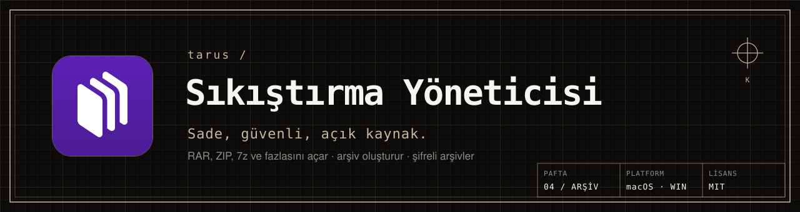
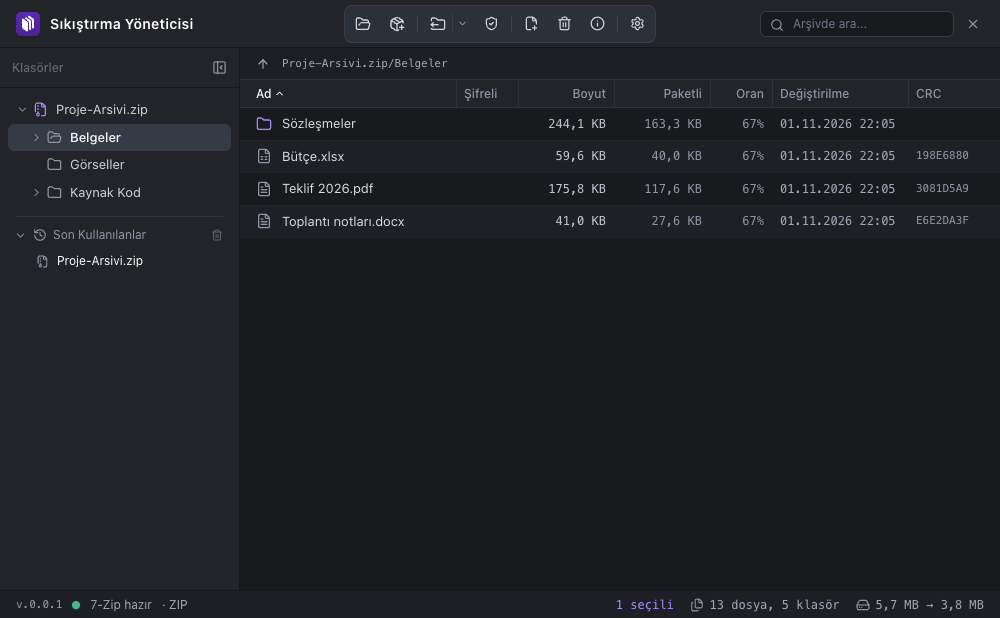
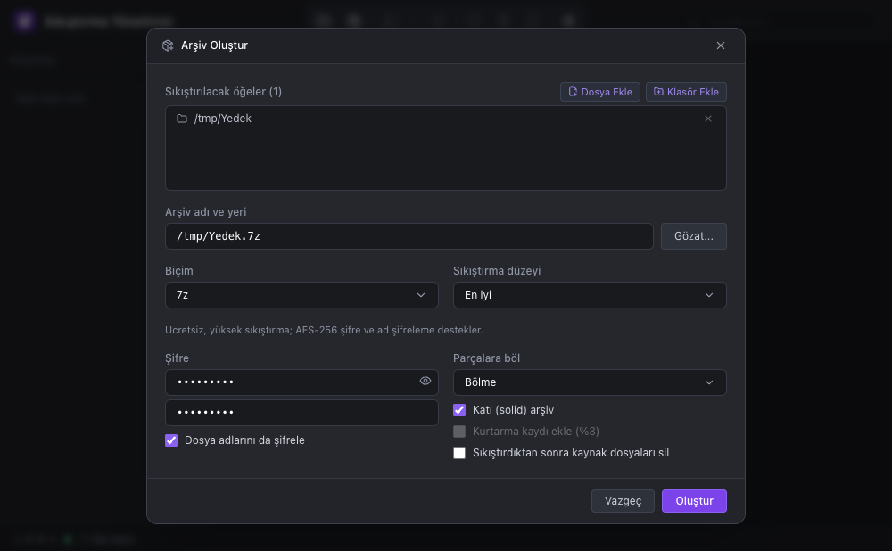
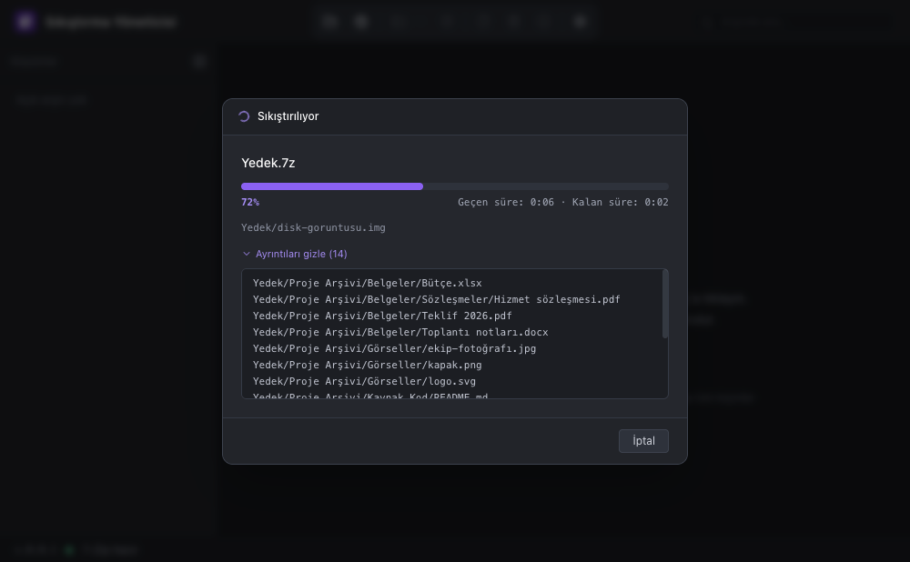

<picture>
  <source media="(prefers-color-scheme: dark)" srcset="docs/readme/afis-koyu.svg">
  <source media="(prefers-color-scheme: light)" srcset="docs/readme/afis-acik.svg">
  
</picture>

<p align="center">
  <a href="LICENSE"></a>
  
  <a href="https://github.com/tarusatolye/sikistirma-yoneticisi/releases/latest"></a>
</p>

**Sıkıştırma Yöneticisi**, macOS ve Windows için sade bir arşiv aracıdır. RAR, ZIP, 7z ve 7-Zip'in okuduğu her biçimi açar; ZIP, 7z ve TAR arşivleri oluşturur, şifreyi yalnız gerektiğinde sorar.



<table>
  <tr>
    <td width="50%"></td>
    <td width="50%"></td>
  </tr>
  <tr>
    <td align="center"><sub><b>01</b> · SIKIŞTIRMA</sub></td>
    <td align="center"><sub><b>02</b> · İLERLEME</sub></td>
  </tr>
</table>

### ◢ Ne yapar

- **Her biçimi açar:** RAR (çok parçalı `.partN.rar` dahil), ZIP, 7z (`.7z.001` dahil), TAR, GZ, BZ2, XZ, ZST, CAB, ISO ve 7-Zip'in okuduğu diğerleri.
- **Arşiv görünümü:** klasör ağacı ve sütunlu tablo (boyut, paketli, oran, tarih, CRC); sıralama ve sütun genişlikleri hatırlanır, arşivin içinde arama yapılır.
- **Çıkartma:** buraya, arşiv adıyla klasöre, seçtiğiniz yere ya da yalnız seçilenleri; aynı adlı dosya varsa üzerine yazma veya yeniden adlandırma sorulur.
- **Arşiv oluşturma:** ZIP, 7z, TAR, TAR.GZ, TAR.XZ, TAR.BZ2; 6 sıkıştırma düzeyi, şifre, dosya adlarını şifreleme, katı arşiv, parçalara bölme.
- **Şifreli arşivler:** şifre yalnız gerektiğinde sorulur, yanlışsa yeniden sorulur.
- **Test, ekle, sil:** arşivi test eder, var olan arşive dosya ekler ya da arşivden siler.
- **Sürükle bırak:** pencereye arşiv bırakınca açılır, dosya bırakınca yeni arşiv hazırlanır.
- **Yerel çalışır:** dosyalarınız bilgisayarınızdan çıkmaz; tüm işlemleri paketle gelen 7-Zip yapar.

### ◢ Kurulum

[**Son sürümü indir →**](https://github.com/tarusatolye/sikistirma-yoneticisi/releases/latest)

| Sistem | Dosya |
|---|---|
| macOS | `Sikistirma-Yoneticisi-<sürüm>-mac.dmg`: açın, uygulamayı *Uygulamalar* klasörüne sürükleyin |
| Windows | `Sikistirma-Yoneticisi-Setup-<sürüm>.exe` kurulum ya da `…-portable.exe` kurulumsuz |

**RAR oluşturmak için:** RAR açmak için ek bir şey gerekmez. RAR arşivi oluşturmak ya da değiştirmek için RARLAB'ın aracı gerekir; lisansı gereği uygulamayla gelmez. Windows'ta WinRAR'ı kurun (`Rar.exe` kendiliğinden bulunur), macOS'ta [rarlab.com](https://www.rarlab.com/download.htm)'dan "RAR for macOS"u indirip uygulama sorduğunda gösterin.

<details>
<summary><b>Kaynaktan derleme</b></summary>

Node.js 20 ya da üstü gerekir. `npm install` 7-Zip motorunu `bin/` altına indirir.

```bash
npm install
npm start            # uygulamayı çalıştırır
npm test             # gerçek 7-Zip ile arşiv oluşturma, listeleme, çıkartma testleri
npm run dist:mac     # macOS: DMG ve ZIP
npm run dist:win     # Windows: kurulum ve taşınabilir exe
```

</details>

### ◢ Lisans ve atıf

[MIT](LICENSE) © 2026 tarusatolye. Mesut Çevik'in macOS için yazdığı [MacRAR](https://github.com/mstcvk/MacRAR) uygulamasından esinlenmiştir; özellikleri ve davranışı ondan alınıp Windows ve macOS için yeniden yazılmıştır (MacRAR © 2026 Mesut Çevik, MIT).

Arşiv işlemleri için [7-Zip](https://www.7-zip.org) (© Igor Pavlov, GNU LGPL) kullanılır ve kendi lisansıyla dağıtılır. RAR © Alexander Roshal, RARLAB; uygulamayla dağıtılmaz.

---

<details>
<summary><b>English</b></summary>

**Sıkıştırma Yöneticisi** (Archive Manager) is a simple archiver for macOS and Windows, inspired by Mesut Çevik's MacRAR. It opens RAR, ZIP, 7z and every format 7-Zip reads, creates ZIP, 7z and TAR archives with passwords, solid mode and volumes, and asks for a password only when needed. Creating RAR needs RARLAB's own tool. Everything stays on your computer. Get it from [Releases](https://github.com/tarusatolye/sikistirma-yoneticisi/releases/latest). MIT licensed.

</details>

<p align="center"><sub><a href="https://tarus.tr">tarus.tr</a> · <a href="mailto:destek@tarus.tr">destek@tarus.tr</a> · PAFTA 04 · ARŞİV · ÇARŞAMBA, SAMSUN</sub></p>
