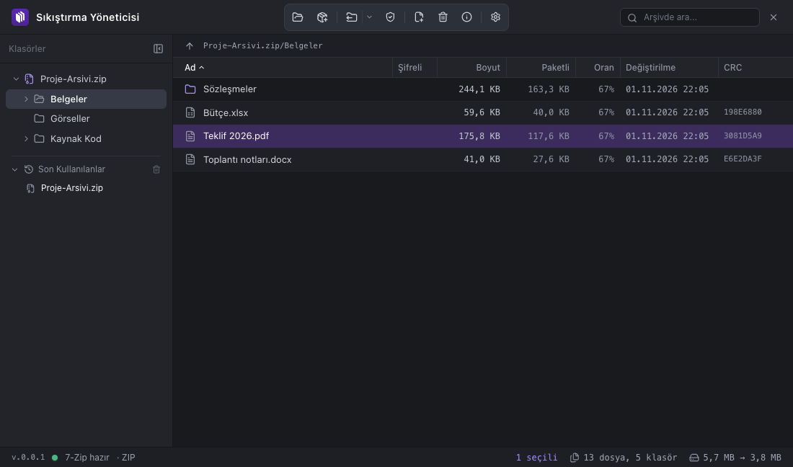

<p align="center">
  
</p>

<h1 align="center">tarus sıkıştırma yöneticisi</h1>

<p align="center">
  Windows ve macOS için modern ve açık kaynak kodlu arşiv yöneticisi.<br>
  RAR, ZIP, 7z, TAR ve 7-Zip'in okuduğu tüm biçimleri açar; ZIP, 7z ve TAR türlerinde arşiv oluşturur.
</p>

<p align="center">
  <a href="https://github.com/tarusatolye/sikistirma-yoneticisi/releases">Sürümler & İndir</a> ·
  <a href="#kurulum">Kurulum Kılavuzu</a>
</p>

<p align="center"></p>

---

## Esin kaynağı: MacRAR

Bu uygulama, **Mesut Çevik**'in yalnızca macOS'ta çalışan, MIT lisanslı [MacRAR](https://github.com/mstcvk/MacRAR) uygulamasından esinlenmiştir. MacRAR'ın özellik listesi ve davranışı (7-Zip `7zz` motoru, şifre döngüsü, iki aşamalı tar.gz açma, üzerine yaz / yeniden adlandır sorusu, sıkıştırma seçenekleri, RAR için kullanıcının kendi RARLAB aracı) temel alınarak, [tarus indirme yöneticisi](https://github.com/tarusatolye/indirme-yoneticisi) ile aynı altyapı ve görünümde Electron ile yeniden yazılmış ve Windows'a taşınmıştır. Swift kodu taşınmamıştır; aynı işlevler JavaScript/TypeScript ile yeniden uygulanmıştır. MacRAR'ın MIT lisans bildirimi [LICENSE](LICENSE) dosyasında korunmaktadır.

## Öne Çıkan Özellikler

- **Arşiv görüntüleme:** İçerik klasör ağacı ve sütunlu tablo olarak açılır (ad, şifreli, boyut, paketli, oran, tarih, CRC). Sütun başlığına tıklayarak sıralanır; sütun genişlikleri ve sıralama hatırlanır. Arama kutusu tüm arşivde arar.
- **Çıkartma:** Buraya çıkart, arşiv adıyla klasöre çıkart, şuraya çıkart, yalnızca seçilenleri çıkart. Hedefte aynı adlı öğe varsa üzerine yaz / yeniden adlandır / atla / vazgeç sorulur. `../` veya mutlak yol içeren arşivler güvenlik için çıkartılmaz.
- **Şifreli arşivler:** Şifre yalnızca gerektiğinde sorulur, yanlışsa yeniden sorulur. İçeriği şifreli ve dosya adları şifreli (7z/RAR) arşivler desteklenir.
- **Sıkıştırma:** ZIP, 7z, TAR, TAR.GZ, TAR.XZ, TAR.BZ2 ve (RARLAB aracıyla) RAR 5. 6 sıkıştırma düzeyi, şifre (7z/RAR'da dosya adlarını da şifreleme), katı arşiv, parçalara bölme, kurtarma kaydı (RAR), kaynakları silme. Biçimin desteklemediği seçenekler kendiliğinden kapanır.
- **İlerleme penceresi:** Toplam yüzde, geçen ve kalan süre, işlenen dosya ve dosya listesi; iptal edilebilir.
- **Test, ekleme, silme, bilgi:** Arşivi test etme, var olan arşive dosya ekleme ve arşivden silme (7z, ZIP, TAR; RAR için RARLAB aracı), arşiv bilgisi penceresi.
- **Sürükle-bırak:** Pencereye bir arşiv bırakınca açılır; dosya veya klasör bırakınca yeni arşiv oluşturma penceresi gelir ya da açık arşive eklenir.
- **Dosya ilişkilendirme:** Kurulumda arşiv uzantıları uygulamaya bağlanır; Gezgin/Finder'da çift tıklayınca açılır (Windows'ta komut satırı argümanı, macOS'ta `open-file`).
- **Türkçe / İngilizce arayüz**, GitHub Releases üzerinden **otomatik güncelleme**.
- **Gizlilik:** Hiçbir dosya adı veya içerik dışarı gönderilmez; tüm işlemler yerelde 7-Zip ile yapılır.

## Desteklenen biçimler

| İşlem | Biçimler |
|---|---|
| Açma / çıkartma / test | RAR (tüm sürümler, çok parçalı `.partN.rar`), ZIP/ZIPX, 7z (`.7z.001` parçalı dahil), TAR, GZ/TGZ, BZ2, XZ, ZST, LZ4, LZMA, CAB, ARJ, LZH, CPIO, ISO, WIM, DEB, RPM, JAR/APK, MSI, CHM, XAR/PKG, DMG, VHD/VMDK ve 7-Zip'in okuduğu diğer biçimler |
| Oluşturma | ZIP, 7z, TAR, TAR.GZ, TAR.XZ, TAR.BZ2; kullanıcının kendi RARLAB aracıyla RAR 5 |
| Ekleme / silme | 7z, ZIP, TAR (tar.gz türleri ve çok parçalı arşivlerde yok); RARLAB aracıyla RAR |
| Şifre | 7z ve RAR: içerik + dosya adları (AES-256); ZIP: içerik (AES-256) |

`tar.gz` türü arşivler iki aşamada açılır: dış katman 7-Zip ile çözülüp iç tar'a borulanır.

### RAR oluşturma

RAR okumak için ek bir şey gerekmez (7-Zip'in unRAR kodu). RAR **oluşturmak** veya RAR arşivini **değiştirmek** için RARLAB'ın aracı gerekir; lisansı gereği uygulamayla dağıtılmaz:

- **Windows:** WinRAR'ı kurun. `C:\Program Files\WinRAR\Rar.exe` kendiliğinden bulunur; başka yere kurduysanız Ayarlar → RAR Aracı'ndan gösterin.
- **macOS:** [rarlab.com](https://www.rarlab.com/download.htm)'dan "RAR for macOS" dosyasını indirin, uygulama sorduğunda `.tar.gz` dosyasını, açtığınız klasörü veya içindeki `rar` programını seçin. `/usr/local/bin/rar` ve `/opt/homebrew/bin/rar` da bulunur.

## Kurulum

### Windows
1. [Sürümler](https://github.com/tarusatolye/sikistirma-yoneticisi/releases) sayfasından `Sikistirma Yoneticisi Setup <sürüm>.exe` dosyasını indirip kurun (veya kurulumsuz `portable` sürümü kullanın).

### macOS
1. [Sürümler](https://github.com/tarusatolye/sikistirma-yoneticisi/releases) sayfasından `.dmg` dosyasını indirin, uygulamayı *Applications* klasörüne sürükleyin.
2. Uygulama Apple tarafından notarize edilmediği için ilk açılışta sağ tık → **Aç** kullanın.

## Klavye kısayolları

| Kısayol | İşlem |
|---|---|
| Ctrl/⌘ + O | Arşiv aç |
| Ctrl/⌘ + N | Arşiv oluştur |
| Ctrl/⌘ + E / ⌥/Alt + Ctrl/⌘ + E / ⇧ + Ctrl/⌘ + E | Buraya / klasöre / şuraya çıkart (seçim varsa yalnızca seçilenler) |
| Ctrl/⌘ + I | Arşiv bilgisi |
| Ctrl/⌘ + F | Arama |
| Enter / Backspace | Aç (klasöre gir, dosyayı varsayılan uygulamayla aç) / üst klasör |
| Delete | Seçilenleri arşivden sil |

## Planlanan

- Gezgin (Windows) ve Finder (macOS) sağ tık menüsü entegrasyonu: "Buraya çıkart", "Arşive ekle" gibi hızlı eylemler.
- Arşiv penceresinden Gezgin/Finder'a sürükleyerek çıkartma.
- SFX (kendiliğinden açılan) arşiv oluşturma.

## Geliştirme ve Kaynaktan Derleme

### Gereksinimler
- Node.js (v20 veya üstü), npm

```bash
# Bağımlılıkları yükler; postinstall 7-Zip motorunu bin/<platform>/ altına indirir
npm install

# Arayüzü derler ve uygulamayı çalıştırır
npm run build
npm start

# Testler (gerçek 7-Zip ile zip/7z/tar arşivleri oluşturup listeler ve çıkartır)
npm test
```

`scripts/fetch-tools.cjs`, 7-Zip'in resmi GitHub sürümlerinden macOS için evrensel `7zz`, Windows için tam `7z.exe` + `7z.dll` (x64 kurulum paketinden çıkartılır) indirir: `node scripts/fetch-tools.cjs --platform mac|win|all`. Uygulama simgeleri `docs/icon.svg`'den `npm run icons` ile üretilir.

### Kurulum paketleri
```bash
# Windows için NSIS kurulum ve portable exe
npm run dist:win

# macOS için DMG ve zip (macOS üzerinde)
npm run dist:mac
```

### Geliştirici ortam değişkenleri

| Değişken | Etkisi |
|---|---|
| `SY_LANG=tr` / `en` | arayüz dilini zorlar |
| `SY_SNAPSHOT=/yol/dosya.png` | `SY_SNAPSHOT_DELAY` saniye sonra (varsayılan 2) pencereyi kaydedip çıkar |

## Dosya yapısı

- `electron/sevenzip.cjs`: 7-Zip çalıştırma, biçim algılama, `7z l -slt` ayrıştırma, boru hattı, ilerleme takibi, komut üreticileri
- `electron/rartools.cjs`: kullanıcının RARLAB aracını bulma / kurma
- `electron/main.cjs`: pencere, IPC, işler, dosya ilişkilendirme, güncelleme
- `src/App.tsx`: ana pencere ve tüm akışlar (şifre döngüsü, çıkartma, sıkıştırma, sürükle-bırak)
- `src/components/`: kenar çubuğu ağacı, arşiv tablosu, sıkıştırma / ilerleme / şifre / bilgi / RAR / ayarlar pencereleri

## Üçüncü taraf yazılımlar

- **7-Zip** © Igor Pavlov, GNU LGPL (unRAR kısıtlamasıyla) ve bazı bölümler için BSD 3-clause. Lisans metni paketlerde `bin/7zip-license.txt` olarak bulunur. Bkz. [7-zip.org](https://www.7-zip.org).
- **RAR** © Alexander Roshal, RARLAB. Paketlenmez; RAR oluşturmak isteyen kullanıcı kendi kopyasını kurar.
- **MacRAR** © Mesut Çevik, MIT. Özellik ve davranış referansı.

## Lisans

Kaynak kodu [MIT Lisansı](LICENSE) ile yayımlanmıştır. © 2026 tarusatolye · © 2026 Mesut Çevik (MacRAR).
